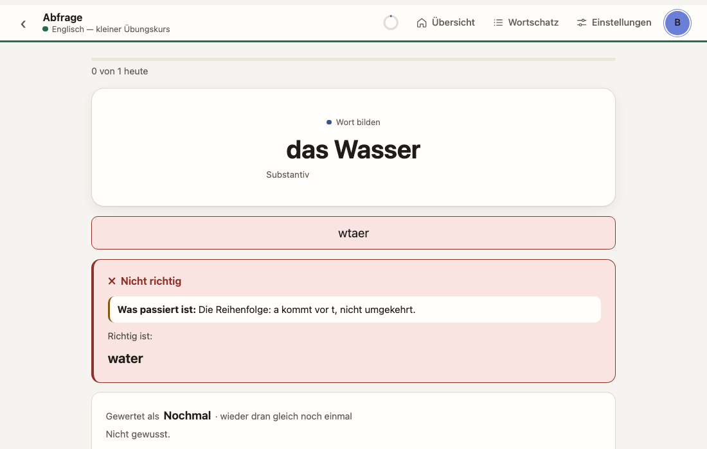
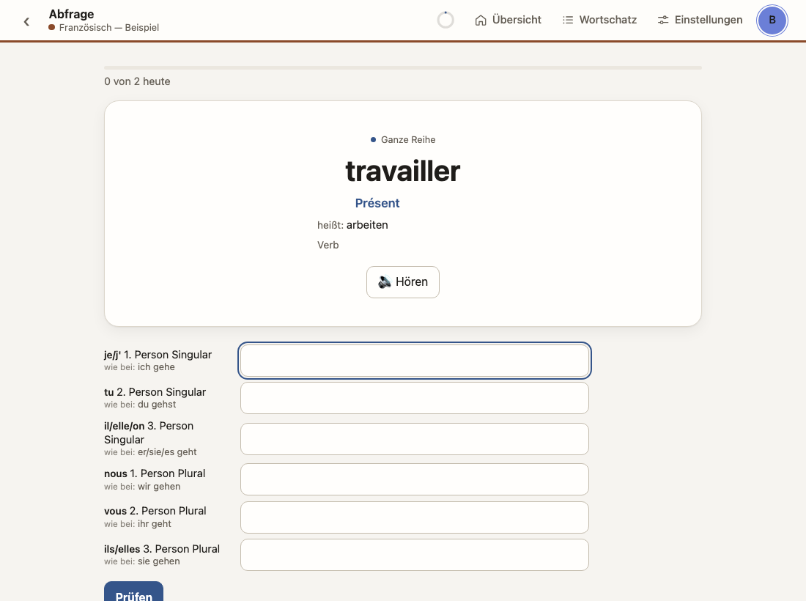
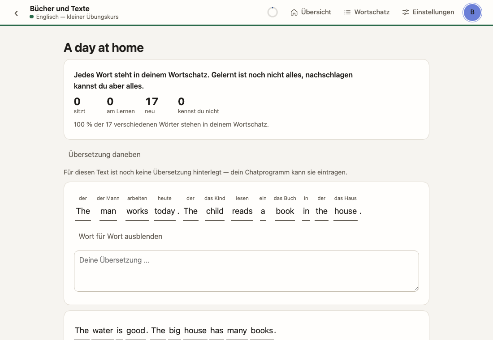
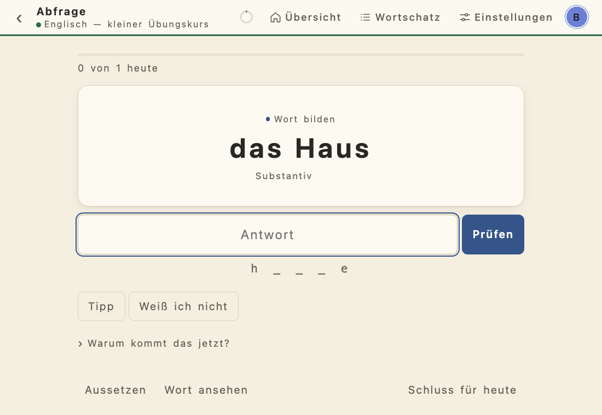
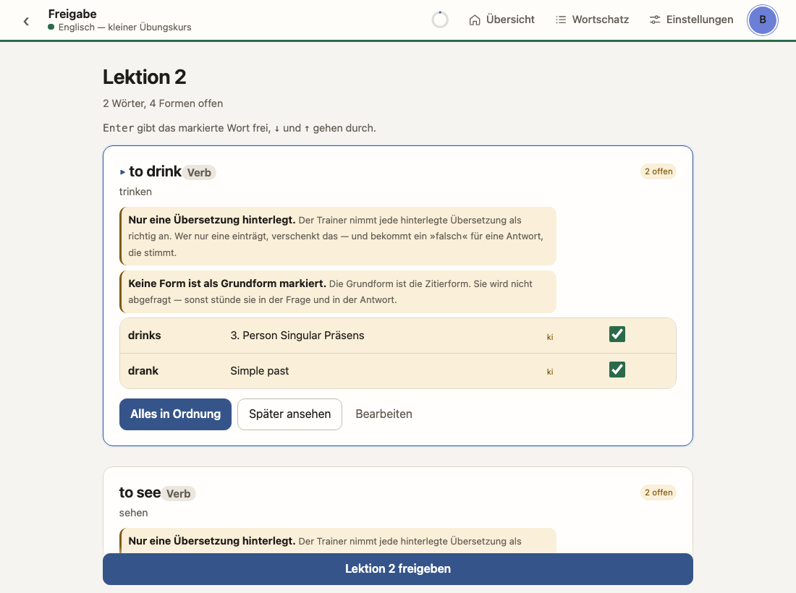

# Donat

[](LICENSE)
[](https://codespaces.new/annichaotica/Donat-Vocabulary-Trainer)

*Deutsch: [README.md](README.md)*

A self-hosted vocabulary trainer that treats a word as a **lexeme with
forms and meanings**, not as a pair of strings — so conjugation,
declension and the mistakes you actually make are things the program can
reason about.

> **Working name.** The project is called *Donat* after Aelius Donatus,
> whose *Ars minor* was the Latin schoolbook of the Middle Ages — for a
> thousand years, long enough that "Donat" became the German word for a
> schoolbook as such. The repository is still named `vokabeltrainer`.

---

## Screenshots

| | |
|---|---|
|  <br> **It names the mistake.** Not "wrong" but *"b and d look alike"*, *"the letters are swapped"*, *"that's the 2nd person singular"*. |  <br> **Whole tables at once.** Six persons of a tense, or the principal parts a verb derives from — graded as one answer, because that is how you know them. |
|  <br> **Reading texts know your vocabulary.** Every word is coloured by what you know, with an interlinear gloss drawn from your own entries. |  <br> **Sixteen switches, not one toggle.** Letter spacing, syllable colouring, stem highlighting, a writing scaffold, no timing. |
|  <br> **Nothing invented gets drilled.** Entries written by a connected AI wait here until a human releases them. | |

---

## What makes it different

Compared with **Anki** and similar card systems:

| | Card systems | Donat |
|---|---|---|
| A word is | front and back | a lexeme with forms (described by feature bundles) and meanings (each with any number of valid translations) |
| Scheduling applies to | the card | **every single task** about the word — "I know the meaning, not the conjugation" is a state the model holds |
| Direction | a second card, authored by hand | follows from the model; no duplicate authoring |
| Grading | you grade yourself | derived from correctness, error type, attempts, hints taken and thinking time — and explained |
| A wrong answer is | wrong | classified: swapped letters, a doubled consonant too many, a confusable shape, a *different form of the same word* |
| Languages | per-deck conventions | a **language profile** — form groups, checking rules, article formation — as data, editable over the API |

Compared with **reading trainers** (LingQ, Readlang and the like):

- Texts live in the same database as the vocabulary, so **coverage** is a
  real number: how many of a text's distinct words you already know.
- The gloss between the lines comes from **your own entries**. It is
  explicitly not a translation and says so.
- Unknown words go on a list that a connected AI works through — with
  frequency and first occurrence.

What it is **not**: a translation engine, a course, a speech trainer, an
app store app, or a learning community. There is no cloud and no account
anywhere but your own machine.

---

## Quick start

### Codespaces — nothing to install

[](https://codespaces.new/annichaotica/Donat-Vocabulary-Trainer)

The container installs the dependencies, creates a sample course and
opens the trainer on port 8030. First build takes a few minutes; after
that it starts in seconds.

### Docker — the finished image

```sh
curl -O https://raw.githubusercontent.com/annichaotica/Donat-Vocabulary-Trainer/main/docker-compose.beispiel.yml
docker compose -f docker-compose.beispiel.yml up
```

Then open <http://localhost:8030>. On an **empty** database the switch
`BEISPIELDATEN=1` creates a demo profile with a small English course —
complete paradigms, a reading text, a learning goal with a deadline, and
a few unapproved AI entries waiting in the approval queue. It never
touches an existing database.

### From source

```sh
python3 -m venv .venv
.venv/bin/pip install -r requirements.txt -r requirements-test.txt
BEISPIELDATEN=1 .venv/bin/uvicorn app:app --app-dir backend --reload --port 8030
```

Tests: `.venv/bin/python -m pytest tests/ -q`

---

## Connecting an AI over MCP

The trainer exposes an **MCP server** with 41 tools, so a chat program
(Claude, ChatGPT) can fill and check the stock: create words, complete
paradigms, set up language profiles, add grammar rules, post reading
texts, generate practice sentences, read the learning state.

Two safeguards, both deliberate:

1. **Forms arrive unapproved.** Anything written over the interface is
   marked `geprueft = 0` and is *not drilled* until a human releases it
   in the approval view. An invented form that gets memorised unnoticed
   is worse than a missing one.
2. **A quality check runs over the stock** and reports stems that cannot
   be derived, duplicate lemmas, translations with slashes, context notes
   that give the answer away, and ambiguous questions.

Setup — URL, account key, Cloudflare Access — is described in the German
README under [»Der MCP-Server«](README.md#der-mcp-server).

---

## License

Free software under the **GNU Affero General Public License, version 3 or
later**. See [LICENSE](LICENSE).

Copyright © 2026 Annuschka Brenner.
